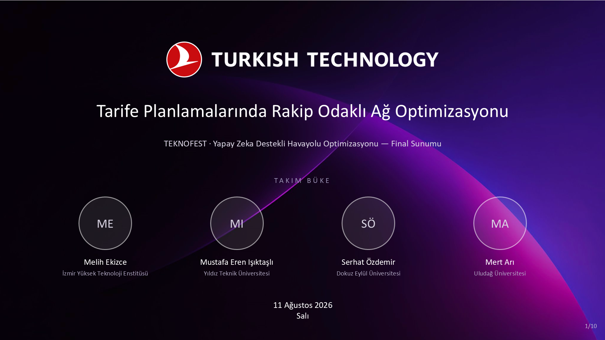
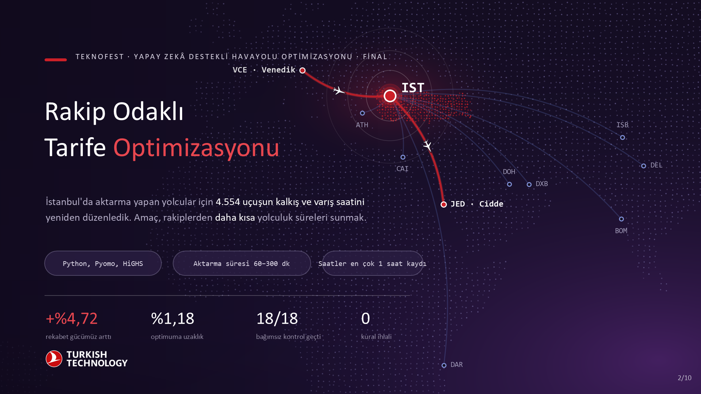
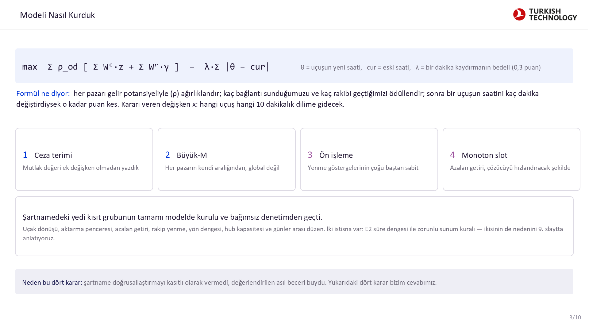
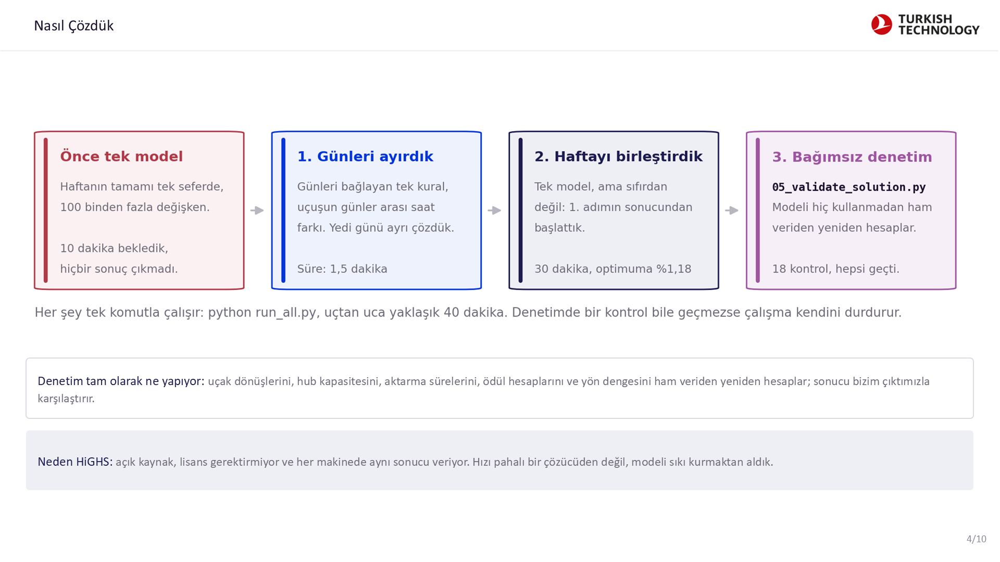
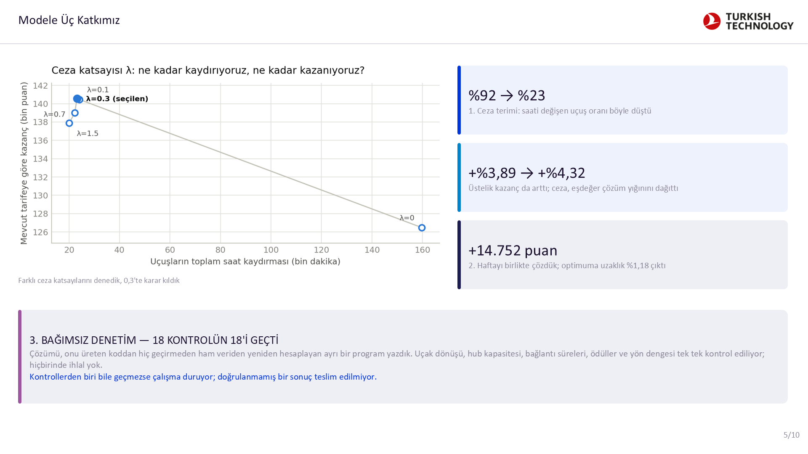
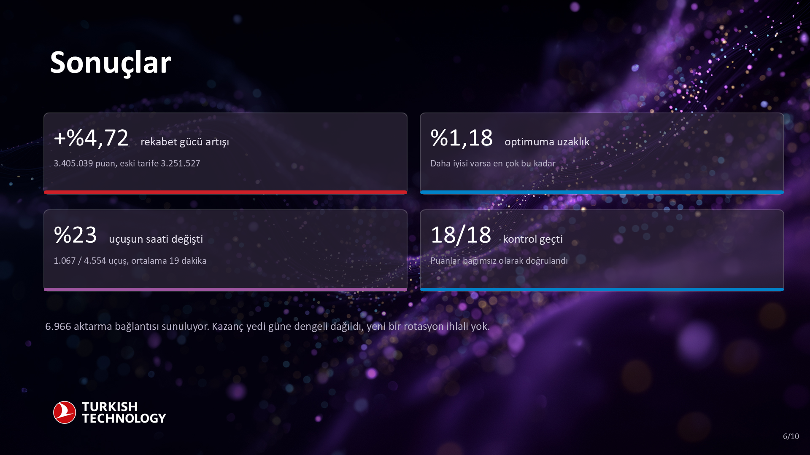
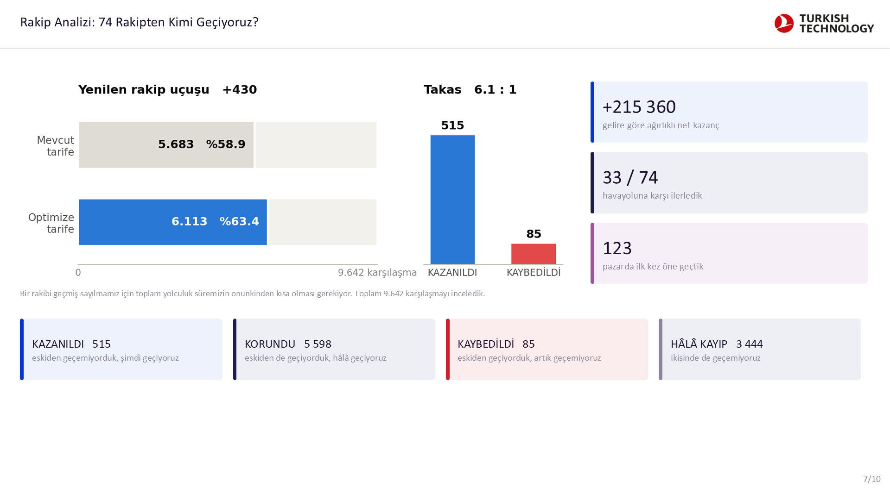
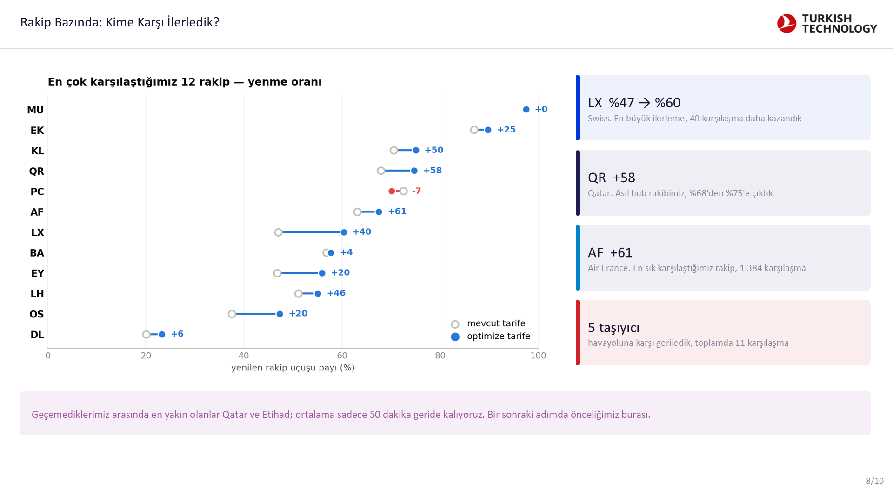
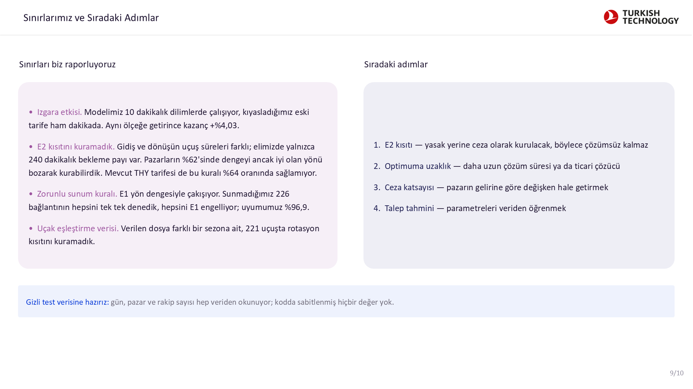
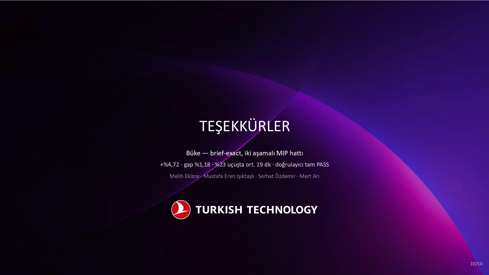

# Sunum Çalışma Kitabı

**Takım Büke** · TEKNOFEST — Yapay Zekâ Destekli Havayolu Optimizasyonu

Her sayfada bir slayt ve o slaytta anlatılacaklar var. Toplam sunum süresi 10 dakika, ardından 5 dakika soru-cevap.

*Kaynak sunum: `Buke_Juri_Sunumu_v3_SADE3.pptx`*


## 1. Tarife Planlamalarında Rakip Odaklı Ağ Optimizasyonu

**Süre:** 30 saniye



### Ne anlatacağız

Sayın jüri, merhaba. Biz Takım Büke: Melih Ekizce, Mustafa Eren Işıktaşlı,
Serhat Özdemir ve Mert Arı.

Tarife planlamasında rakip odaklı ağ optimizasyonu problemi için geliştirdiğimiz
çözümü anlatacağız. Sırasıyla: problemi nasıl modelledik, nasıl çözdük, neler
ekledik ve sonuçları nasıl doğruladık.


```{=openxml}
<w:p><w:r><w:br w:type="page"/></w:r></w:p>
```

## 2. Rakip Odaklı Tarife Optimizasyonu

**Süre:** 1 dakika



### Ne anlatacağız

Tek cümleyle özet: İstanbul'daki 4.554 uçuşun saatini yeniden düzenleyerek
rekabet gücümüzü yüzde 4,72 artırdık. Bunu yaparken uçuşların sadece yüzde
23'üne dokunduk, ortalama 19 dakika.

Haritadaki kırmızı hat tipik bir örnek: Venedik'ten Cidde'ye giden yolcu
İstanbul'da aktarma yapıyor. Bu yolcunun bizi seçip seçmemesi toplam yolculuk
süresine bağlı. Toplam süre üç parçadan oluşuyor: geliş uçuşu, İstanbul'daki
bekleme ve gidiş uçuşu. Uçuş sürelerini değiştiremeyiz; tek kaldıracımız
İstanbul'daki saatler.

Bekleme 60 dakikanın altına inerse yolcu ve bagajı yetişemiyor. 300 dakikanın
üstüne çıkarsa yolcu Frankfurt, Doha veya Dubai üzerinden giden rakibi tercih
ediyor. Yani hem çok kısa hem çok uzun bekleme bizi kaybettiriyor.

Alttaki iki rakam güvence: sonucun optimuma uzaklığı en fazla yüzde 1,18 ve
bağımsız kontrollerin hepsi geçti.


```{=openxml}
<w:p><w:r><w:br w:type="page"/></w:r></w:p>
```

## 3. Modeli Nasıl Kurduk

**Süre:** 1,5 dakika



### Ne anlatacağız

GİRİŞ
Bu slaytta modelin kendisi var. Kısıtları tek tek okumayacağım, onları zaten
siz yazdınız. Ben bizim ne yaptığımıza odaklanayım.

FORMÜLÜ SOLDAN SAĞA OKUYALIM

"max" ile başlıyor, yani bu değeri en büyük yapmaya çalışıyoruz.

Rho: her O-D pazarının gelir potansiyeli. Bunu baştan çarpan olarak koyduk
çünkü her pazar aynı değerde değil. İstanbul üzerinden Venedik'ten Cidde'ye
giden yolcu sayısıyla küçük bir hattaki yolcu sayısı aynı değil. Rho sayesinde
model, kısıtlı kaydırma bütçesini değerli pazarlara harcıyor.

Köşeli parantezin içinde iki ödül var.

Birincisi bağlantı ödülü. Bir pazarda kaç tane geçerli aktarma seçeneği
sunduğumuzu ölçüyor. Ama azalan getirili: ilk bağlantı 1 puan, ikincisi yarım,
üçüncüsü çeyrek diye gidiyor. Bunun mantığı şu: bir pazara günde hiç seçenek
sunmamakla bir seçenek sunmak arasında büyük fark var; dokuz seçenekle on
seçenek arasında neredeyse fark yok, yolcu zaten en uygun ilk birkaçını
alıyor. Bu sayede model tek bir pazara bağlantı yığıp puan şişiremiyor,
ağa yaymak zorunda kalıyor.

İkincisi sıralama ödülü. Kaç rakibi geçtiğimize göre değişiyor. Bir pazarda
sekiz rakip varsa ve biz beşinciysek, üç rakibi geçip ikinciye çıkmanın
ticari değeri sizin verdiğiniz tabloda yazılı. Biz o tabloyu birebir okuyoruz,
kendimiz bir değer uydurmuyoruz.

CEZA TERİMİ — BİZİM EKLEDİĞİMİZ

Formülün sonundaki eksili kısım şartnamede yok, biz ekledik.

Theta bir uçuşun yeni saati, cur ise mevcut tarifedeki eski saati. Aradaki
farkın mutlak değeri, o uçuşu kaç dakika kaydırdığımız.

Lambda ise bunun katsayısı, biz 0,3 seçtik. Lambdayı bir kur oranı gibi
düşünün: bir uçuşu bir dakika kaydırmanın bedeli 0,3 puan. Yani model bir
uçuşu ancak o kaydırmanın getirisi bu bedeli aşıyorsa oynatıyor. Bedava
kaydırma yok.

Neden ekledik? Çünkü şartnamenin amacı açısından bir uçuşu yerinde bırakmakla
kaydırmak tamamen eşdeğerdi. Model de bundan faydalanıp hiçbir işe yaramayan
kaydırmalar yapıyordu. Gerçek hayatta her saat değişikliği bir maliyet:
slot başvurusu, ekip planı, yer hizmetleri, bağlantı dalgası.

Ve çok önemli bir nokta: kazancımızı hesaplarken bu cezayı geri çıkarmıyoruz.
Yani raporladığımız yüzde 4,72 saf rekabetçilik kazancı; ceza sadece hangi
kaydırmaların yapılacağını süzüyor, puanımızı şişirmiyor.

KARAR DEĞİŞKENİ

Asıl karar x: hangi uçuş hangi 10 dakikalık dilime atanacak. Sunulan bağlantı
sayısı da, geçtiğimiz rakip sayısı da, sıralama da hep bundan türüyor.
Toplamda yaklaşık 100 bin ikili değişken var.

ORTADAKİ DÖRT KUTU — ASIL ANLATMAK İSTEDİĞİM KISIM

Şartname diyor ki: "kısıtları gereksinim düzeyinde veriyoruz, bunların
doğrusallaştırılmasını bilinçli olarak vermiyoruz; doğru ve sıkı bir
formülasyon kurmak değerlendirilen çekirdek beceridir." Bu dört kutu bizim
cevabımız.

Bir: ceza terimi. Bir mutlak değeri optimizasyon modeline koymak normalde
zordur, yardımcı değişken ve büyük-M gerektirir. Bizde her uçuş tam olarak bir
dilime atandığı için, kaydırma miktarını doğrudan atama değişkeninin
katsayısına gömdük. Tek bir ek değişken bile eklemedik.

İki: büyük-M. Koşullu kısıtları yazarken kullanılan bir sabit. Bunu çok büyük
seçerseniz model doğru çalışır ama çözücü yavaşlar, çünkü gevşetme bozulur.
Biz her büyük-M'i tüm ağdan değil, o pazarın kendi süre aralığından hesapladık.
Böylece mümkün olan en sıkı değeri kullandık.

Üç: ön işleme. Bir bağlantının bir rakibi geçip geçemeyeceği çoğu durumda
baştan bellidir. Uçuş süreleri zaten rakipten uzunsa hiçbir saatte geçemez,
zaten çok kısaysa her saatte geçer. Bu iki durumu değişken yapmadık, sabit
olarak yazdık. Büyük-M sadece gerçekten belirsiz olan orta durumda kuruluyor.

Dört: monoton slot. Azalan getiriyi sıralı göstergelerle kurduk, ikinci slot
ancak birinci doluysa dolabiliyor. Bu hem doğru modelleme hem de çözücüyü
hızlandıran bir sıkılaştırma.

ALTTAKİ ŞERİT
Yedi kısıt grubunun tamamı kurulu ve bağımsız denetimden geçti. İki istisna
var, onları dokuzuncu slaytta gerekçesiyle anlatacağım.


```{=openxml}
<w:p><w:r><w:br w:type="page"/></w:r></w:p>
```

## 4. Nasıl Çözdük

**Süre:** 1,5 dakika



### Ne anlatacağız

Soldan sağa okuyalım.

Önce haftanın tamamını tek modelde çözmeyi denedik. Yüz binden fazla değişken
var. 10 dakika bekledik, çözücü hiçbir sonuç bulamadı.

Sonra şunu fark ettik: günleri birbirine bağlayan tek kural, aynı uçuşun günler
arasındaki saat farkı. Diğer her şey gün içinde kalıyor. Bu yüzden yedi günü
ayrı ayrı çözdük, bir buçuk dakika sürüyor.

İkinci adımda haftayı tekrar birleştirdik ama sıfırdan başlatmadık; birinci
adımın sonucunu başlangıç noktası olarak verdik. Çözücü iyi bir yerden devam
ettiği için 30 dakikada hem sonucu iyileştirdi hem de optimuma uzaklığın
yüzde 1,18'den az olduğunu kanıtladı.

Üçüncü adım bizim için en önemlisi. "Ayrı bir program denetliyor" derken şunu
kastediyoruz: 05_validate_solution.py diye bir betik yazdık ve bu betik model
kodunu hiç kullanmıyor. Ham veriyi ve bizim çıktımızı alıp uçak dönüşlerini,
hub kapasitesini, aktarma sürelerini, ödül hesaplarını ve yön dengesini
sıfırdan yeniden hesaplıyor, sonra bizim rakamlarımızla karşılaştırıyor.
Muhasebedeki çift kayıt mantığı. 18 kontrolün hepsi geçiyor.

Bir kontrol bile geçmezse çalışma kendini durduruyor; yani doğrulanmamış bir
sonuç teslim edilmiyor.


```{=openxml}
<w:p><w:r><w:br w:type="page"/></w:r></w:p>
```

## 5. Modele Üç Katkımız

**Süre:** 1,5 dakika — EN ÖNEMLİ SLAYT



### Ne anlatacağız

Üç şeyden bahsedeceğim.

Birincisi ceza terimi. Soldaki grafiği şöyle okuyun: her nokta farklı bir ceza
katsayısı. Sağa gittikçe uçuşları daha çok kaydırıyoruz, yukarı gittikçe mevcut
tarifeye göre daha çok kazanıyoruz.

Sağ alttaki nokta cezasız hâl: 160 bin dakika kaydırma yapıyor ama sadece
126 bin puan kazandırıyor. Uçuşların yüzde 92'sini oynatıyor, operasyonel
olarak uygulanamaz.

Sol üstteki küme cezalı hâl: 20 ile 24 bin dakika arasında kaydırmayla
138–140 bin puan. Yani yedi kat daha az kaydırıp daha çok kazanıyoruz.

Beklemediğimiz şey buydu. Sebebi ilginç: cezasız modelde aynı puanı veren
binlerce farklı çözüm var, çözücü bunların arasında boğuluyor. Ceza bu yığını
dağıtınca çözücü aynı sürede daha iyi bir sonuca ulaşabildi. Yani ceza hem
gerçekçiliği hem çözüm kalitesini artırdı.

0,1 ile 1,5 arasında sonuç kararlı; 0,3'te karar kıldık çünkü hem en yüksek
kazancı veriyor hem daha az uçuş kaydırıyor.

İkincisi: haftayı birlikte çözmek 14.752 puan daha kazandırdı. Ama asıl değerli
olan, optimuma uzaklığın kanıtlanması. "İyi bir sonuç bulduk" demiyoruz,
ne kadar iyi olduğunu ölçüyoruz.

Üçüncüsü denetim. Modeli yazan kişinin kendi sonucunu kontrol etmesi güvenilir
değil. O yüzden ham veriden başlayıp her şeyi yeniden hesaplayan ayrı bir
program yazdık. 18 kontrolün hepsi geçiyor. Geliştirme sırasında bu program
üç gerçek hatayı yakaladı: aynı bağlantıya iki kez ödül verilmesi, aynı uçuşun
veride iki kez görünmesi ve kapasite hesabında eksik kalan uçuşlar. Üçünü de
düzelttik.


```{=openxml}
<w:p><w:r><w:br w:type="page"/></w:r></w:p>
```

## 6. Sonuçlar

**Süre:** 1 dakika



### Ne anlatacağız

Dört ana sayı var.

BİRİNCİSİ — kazanç
Rekabet gücümüz yüzde 4,72 arttı. Puan olarak 3 milyon 251 binden 3 milyon
405 bine çıktı, aradaki fark 153 bin puan.

İKİNCİSİ — optimuma uzaklık yüzde 1,18. Bunu biraz açayım, çünkü bence
slayttaki en değerli sayı bu.

"Mükemmel çözüm" derken şunu kastediyoruz: 4.554 uçuşun saatini ayarlamanın
akıl almaz sayıda farklı yolu var. Bunların arasında en yüksek puanı veren bir
tanesi mutlaka vardır. İşte o teorik en iyi tarifeye mükemmel çözüm diyoruz.
Onu tek tek deneyerek bulmak imkânsız.

Peki ona ne kadar yaklaştığımızı nereden biliyoruz? Çözücü aynı anda iki iş
yapıyor.

Birincisi: geçerli tarifeler üretiyor ve en iyisini elinde tutuyor. Bu bizim
alt sınırımız, yani "en az bu kadarını başarabiliyoruz."

İkincisi, asıl kritik olan: bir tavan hesaplıyor. Bunu, problemi kasıtlı olarak
kolaylaştırarak yapıyor. Örneğin bir uçuşun yarısının 10:00 diliminde, yarısının
10:10 diliminde olmasına izin veriyor. Gerçekte böyle bir şey olamaz, ama bu
gevşetilmiş problemin cevabı gerçek en iyi çözümden asla düşük olamaz.
Yani matematiksel bir tavan elde ediyoruz: "hiçbir tarife bu değeri geçemez."

Sonra çözücü dallandırarak bu tavanı adım adım aşağı çekiyor, elindeki çözümü
de yukarı itiyor. İkisi arasındaki mesafeye optimuma uzaklık deniyor.

Bizde bu mesafe yüzde 1,18'e kadar indi. Yani şunu kanıtlamış oluyoruz:
mükemmel tarife her neyse, bizim bulduğumuzdan en fazla yüzde 1,18 daha iyi
olabilir. Bu bir tahmin değil, çözücünün ürettiği bir kanıt.

Bunu neden vurguluyorum? Çünkü bu olmadan sadece "iyi bir sonuç bulduk"
diyebilirdik. Şimdi "ne kadar iyi olduğunu da biliyoruz" diyoruz.
Not: bu ölçü, çözücünün optimize ettiği amaç üzerinden, yani ceza terimi dahil
hesaplanıyor.

ÜÇÜNCÜSÜ — uçuşların sadece yüzde 23'ünün saatini değiştirdik, ortalama
19 dakika. Yüzde 77'si hiç oynamadı. Operasyonu alt üst eden bir tarife değil.

DÖRDÜNCÜSÜ — hepsi bağımsız kontrolden geçti.

ALT SATIR
Kazanç yedi güne dengeli dağılıyor, her gün 19 ile 24 bin puan arasında.
Yani tek bir günün özel durumundan gelen kırılgan bir kazanç değil.


```{=openxml}
<w:p><w:r><w:br w:type="page"/></w:r></w:p>
```

## 7. Rakip Analizi: 74 Rakipten Kimi Geçiyoruz?

**Süre:** 1 dakika



### Ne anlatacağız

Buraya kadar puan konuştuk. Şimdi bunun rekabet açısından ne anlama geldiğine
bakalım.

Ölçüt basit: bir rakibi geçmiş sayılmamız için toplam yolculuk süremizin
onunkinden kısa olması gerekiyor. Veride 74 farklı havayoluyla toplam
9.642 karşılaşmamız var.

Sonuç: 74 havayolunun 33'üne karşı net ilerleme kaydettik ve 123 pazarda ilk
kez öne geçtik.

Alttaki dört kutu resmin tamamı. 515 karşılaşmayı kazandık, 5.598'inde zaten
öndeydik ve öyle kaldık. Dürüst olmak gerekirse 85 karşılaşmayı da kaybettik.
Kazandığımız kaybettiğimizin altı katı, gelire göre ağırlıklandırınca da
lehimize.

3.444 karşılaşmada hâlâ geçemiyoruz. Bunu saklamıyoruz, geliştirme alanımız.

Son satır önemli: çıktı dosyamız 4.914 rakibi geçtiğimizi söylüyor ama bağımsız
ölçüm 6.113 buluyor. Yani puanımızı şişirmiyoruz, aksine olduğundan düşük
gösteriyoruz.


```{=openxml}
<w:p><w:r><w:br w:type="page"/></w:r></w:p>
```

## 8. Rakip Bazında: Kime Karşı İlerledik?

**Süre:** 1 dakika



### Ne anlatacağız

Rakip bazında birkaç örnek.

En büyük ilerlemeyi Swiss'e karşı yaptık, yüzde 47'den 60'a çıktık.

Qatar bizim için daha anlamlı çünkü o da bizim gibi bir aktarma merkezi
işletiyor, yani asıl rakibimiz. Ona karşı 58 karşılaşma daha kazandık.

Air France en sık karşılaştığımız rakip, 1.384 karşılaşma var ve 61'ini daha
kazandık.

Dürüstlük payı: beş havayoluna karşı geriledik, toplamda 11 karşılaşma.
Çoğu Pegasus'a karşı.

Son cümle stratejik: hâlâ geçemediklerimiz arasında en yakın olanlar Qatar ve
Etihad. Onlara ortalama sadece 50 dakika geride kalıyoruz. Yani küçük
iyileştirmelerle kazanılabilecek karşılaşmalar. Bir sonraki adımda önceliğimiz
burası.


```{=openxml}
<w:p><w:r><w:br w:type="page"/></w:r></w:p>
```

## 9. Sınırlarımız ve Sıradaki Adımlar

**Süre:** 1 dakika



### Ne anlatacağız

Bu slaytta eksiklerimizi siz sormadan biz söylüyoruz.

Birincisi bir ölçüm farkı. Modelimiz 10 dakikalık dilimlerde çalışıyor ama
karşılaştırdığımız eski tarife ham dakikada. Aynı ölçeğe getirdiğimizde kazanç
yüzde 4,72 değil yüzde 4,03. İkisini de raporluyoruz.

İkincisi E2 kısıtı, yani iki yönün en iyi süreleri arasındaki denge. Şunu
anlatayım: yolculuk süresi uçuş süresi artı İstanbul'daki bekleme. Uçuş
süresini biz belirlemiyoruz, o rüzgâr ve rota. Elimizde sadece 240 dakikalık
bekleme payı var. Ölçtük: pazarların yüzde 62'sinde iki yönü dengelemenin tek
yolu iyi olan yönü bozmak, yani yolcuyu boşuna bekletmek. On pazarda ise
hiçbir tarife bunu sağlayamıyor, matematiksel olarak imkânsız. Mevcut THY
tarifesi de bu kuralı yüzde 64 oranında sağlamıyor. Doğru çözüm kısıtı yasak
yerine ceza olarak kurmak; yol haritamızın birinci maddesi bu.

Üçüncüsü zorunlu sunum kuralı. Bu kural yön dengesi kısıtıyla çakışıyor.
Sunmadığımız 226 bağlantıyı tek tek test ettik: hepsini yön dengesi engelliyor.
Yani bizim tercihimiz değil.

Dördüncüsü veri kaynaklı. Uçak eşleştirme dosyası farklı bir sezona ait,
221 uçuşta rotasyon kısıtını kuramadık.

Sağda sıradaki adımlar var. Gizli test verisiyle çalışmaya hazırız; kodda
sabitlenmiş hiçbir değer yok.


```{=openxml}
<w:p><w:r><w:br w:type="page"/></w:r></w:p>
```

## 10. TEŞEKKÜRLER

**Süre:** 30 saniye



### Ne anlatacağız

Özetle: iki aşamalı bir optimizasyon modeli kurduk. Mevcut tarifeye göre
rekabet gücünü yüzde 4,72 artırıyor, uçuşların sadece yüzde 23'üne ortalama
19 dakika dokunuyor ve optimuma uzaklığı yüzde 1,18 olarak kanıtlanmış durumda.

Bizim için asıl önemli olan şu: bu sadece bir skor değil. Denetlenebilir,
tekrar üretilebilir ve gizli test verisine hazır bir çalışma.

Dinlediğiniz için teşekkür ederiz. Sorularınızı bekliyoruz.


```{=openxml}
<w:p><w:r><w:br w:type="page"/></w:r></w:p>
```

## Süre planı

| Slayt | Süre |
|---|---|
| 1 | 30 saniye |
| 2 | 1 dakika |
| 3 | 1,5 dakika |
| 4 | 1,5 dakika |
| 5 | 1,5 dakika — EN ÖNEMLİ SLAYT |
| 6 | 1 dakika |
| 7 | 1 dakika |
| 8 | 1 dakika |
| 9 | 1 dakika |
| 10 | 30 saniye |

Sunum 10 dakika ile sınırlı. Provada her slaytta kalan süreyi kontrol edin; 5. ve 9. slaytlar en kritik olanlar, gerekirse 7. ve 8. slaytları hızlandırın.
