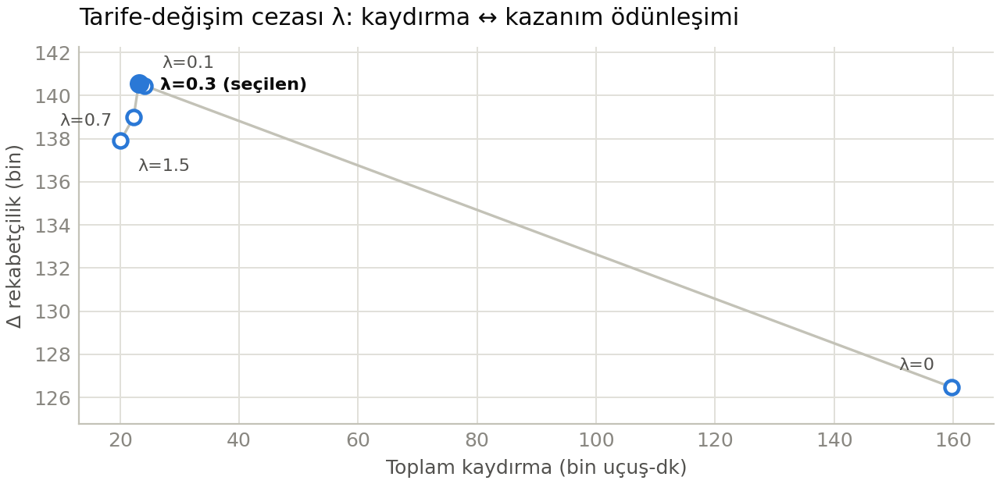
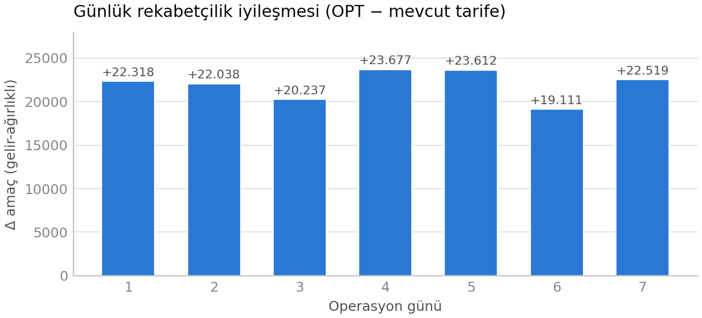

# Teknik Rapor — Tarife Planlamalarında Rakip Odaklı Ağ Optimizasyonu

**Takım: Büke** · **TEKNOFEST · Yapay Zeka Destekli Havayolu Optimizasyonu**
IST hub aktarma ağı · Karışık Tamsayılı Programlama (MIP) · Pyomo + HiGHS

> Bu rapor formülasyon gerekçelerini, varsayımları, doğrusallaştırma seçimlerini ve sonuç
> tartışmasını özetler. Tam matematiksel formülasyon `docs/model_formulation.md`'dedir; çalışan
> kod `src/` (çözücü: 03 + 08), çıktılar `output/`, kurulum/çalıştırma `README.md`.

---

## 1. Problem ve Yaklaşım

İstanbul (IST) merkez üssü üzerinden aktarmalı O–D pazarlarında, **ayarlanabilir uçuşların IST
kalkış/varış saatlerini** belirleyerek gelir-ağırlıklı toplam rekabetçilik faydasını enbüyüklüyoruz.
Her O–D/gün için fayda iki bileşenden oluşur ve gelir potansiyeli ρ_od ile ölçeklenir:

- **Bağlantı-sayısı ödülü** (azalan getiri): sunulan j. uygun aktarma bağlantısı Wᶜ_j = (½)ʲ⁻¹ puan.
- **Sıralama ödülü**: bir bağlantının toplam yolculuk süresi J_π bir rakibinkini geçtiğinde o rakip
  "yenilir"; yenilen rakip sayısı son sıralamayı (r = N − yenilen) ve lookup ödülünü Wʳ belirler.

Karar değişkeni, ayarlanabilir her uçuş örneğinin IST saatidir (10 dk'lık kovalarda, mevcut saatin
±60 dk penceresinde); bağlantı boşlukları, uygunluk, yenme ve sıralama bundan **türetilir**. Çözüm
yaklaşımımız tek bir MIP'tir (sezgisel değil); ölçek için iki aşama kullanılır: güne-göre ayrıştırma
+ tam-hafta MIP-start cilalaması (§4). **Örnek boyutu (tam veri):** 7 gün, 4 660 O–D/gün pazarı,
~7 700 aday bağlantı, ~100k ikili değişken. Çözücü: **HiGHS** (Pyomo `appsi_highs`), açık-kaynak.

---

## 2. Veri Ele Alma ve Varsayımlar ("Minimal + Belgeli")

Orijinal Excel dosyalarına dokunulmadı; tek müdahale fiziksel imkânsız satırların düzeltimidir.
Modeli etkileyen başlıca varsayımlar (gerekçeleriyle):

- **V1 — Yolculuk süresi J = legsum + boşluk;** `legsum` (bacak blok toplamı) sabit veridir:
  güncellenmiş veride `ElapsedTime1/2` verildiğinden `legsum = E1+E2` doğrudan veriden, J **kesin**.
- **V2 — J'de sarma (wrap) belirsizliği yok:** kesin J, Gate-to-Gate ile tüm satırlarda mod-24sa
  çapraz doğrulandı (eski şemanın de-wrap'i 24sa+ 495 itinerary'nin 154'ünü kaçırıyordu;
  ElapsedTime'sız şema gelirse kod de-wrap'e otomatik döner — `derived/transform_log.md`).
- **V3 — Rakip sayısı N_od taşıyıcı bazlı** (itinerary değil): taşıyıcı bazlı N ∈ [1,17] ≤ 40 olup
  ranking lookup'ı tam kapsar; itinerary bazlı 73 pazarda 40'ı aşıp lookup dışına çıkar.
- **V4 — İhtiyatlı dışlama:** ρ tanımsız 48 pazar amaçtan dışlanır; rotasyon partneri olmayan
  176 TK uçuşu sabittir (değer uydurulmaz).
- **V5 — A2 rotasyon brief-exact minimum tur:** θ_in − θ_out ≥ min(T_OB+τ+T_IB, mevcut tur), τ=45 dk;
  bloklar veriden. Mevcut turu minimumun altında gösteren çiftler gece-aşan rotasyondur: aynı-gün
  izdüşümünde mevcut çapa korunur, fiziksel kısıt gerçek zaman ekseninde doğrulanır (yeni ihlal: 0).
- **V6 — b_od taban sıralaması, baseline'ın 'son sırası' (s) ile aynı tabandan:** sıralama bir
  *iyileştirme* ödülüdür; mevcut tarife her pazarda lookup köşegenine (b==s nötrü) oturur → model
  iç-tutarlı. Kesin konvansiyon organizatör teyidi bekliyor (`docs §9`).
- **V7 — Hafta normalizasyonu + aday tekilleştirme:** takvim-haftası kopyaları tek kanonik haftaya
  çekilir (boşluk/J değişmez), özdeş adaylar tekilleştirilir (5 604→5 474 olay; 7 850→7 693 aday).
  Aksi hâlde aynı fiziksel uçuş iki karar olayı olur ve aynı bağlantı **çift ödül** yazdırır — bu
  açığı **bağımsız doğrulayıcı** yakaladı.

---

## 3. Formülasyon ve Doğrusallaştırma Kararları

Tüm gereksinim-düzeyi kısıtlar (A–G) doğrusal MIP olarak kuruldu. Değerlendirmenin çekirdeği olan
**sıkı doğrusallaştırma** için aldığımız kararlar:

- **(A1) Zaman ayrıklaştırma → büyük-M'siz uygunluk.** Her olay 10 dk kovaya atanır (Σ_t x = 1);
  bağlantı penceresi tam tamsayı olur, katı eşitsizlik (ε) sorunu kalkar.
- **(B/D) Yön-yerel büyük-M.** Boşluk (y_π) ve yenme göstergelerinde M, **global değil
  pazar/örnek-yerel** menzilden hesaplanır; gevşek M, LP gevşetmesini bozup süreyi artırırdı.
- **(D) Yenme göstergesinde büyük-M'den KAÇINMA (ön-işleme).** G_{πk} = Tᶜᵒᵐᵖ − legsum eşiğine göre
  üç durum: *(i)* asla yenemez → değişken yok; *(ii)* sunulunca hep yener → **w = y** (M'siz);
  *(iii)* yalnız ara durumda koşullu büyük-M. Çoğu (π,k) ya veri ya basit eşitlik olur.
- **(C) Azalan getiri = monoton slotlar.** Σ y = Σ z, z_j ≥ z_{j+1}; monotonluk LP gevşetmesini sıkar.
- **(E2) Min-seçimi McCormick'siz.** Jmin = Σ(legsum+g)·σ bilineerdir; yerine Jmin ≤ J_π+M(1−y),
  Jmin ≥ J_π−M(1−u), Σu = act, u ≤ y ile **tam doğrusal** argmin kurulur.
- **(A2) Rotasyon brief-exact + gece-aşan koruması.** Aynı-gün turlarda θ_in − θ_out ≥ T_OB+τ+T_IB
  (bloklar veriden, τ=45). Turu h→h+1'e yayılan çiftlerde mevcut pay (slack) statik ikiye bölünür
  (kalkış ≤ slack/2 geç, dönüş ≤ slack/2 erken) → minimum tur **yapısal garanti** + gerçek zaman
  ekseninde doğrulama.
- **(P) Cezada büyük-M'siz mutlak değer.** A1'in tekil-atama yapısı sayesinde
  |θ−cur| = Σ_v |v−cur|·x — yardımcı değişkensiz tam doğrusal (§5).

---

## 4. Ön-İşleme, Sıkılaştırma ve Ölçekleme

**Ön-işleme (model boyutu ↓, M ihtiyacı ↓).** (i) Hiçbir pencere konumunda [L,U]'ya giremeyen
bağlantı adayları elenir; (ii) yenme göstergeleri G_{πk} ile üç duruma ayrılır (§3); (iii) kapasitesi
sıfır kovalar pencereden çıkarılır; (iv) ρ tanımsız pazarlar dışlanır. Sabit–sabit bağlantılarda
boşluk/J/yenme **veri** olarak hesaplanır, değişken yaratılmaz.

**Hub kapasitesi (F) — brief'in gerçek 10/15'i, TÜM TK uçuşlarıyla.** Mevcut tarifede bazı kovalar
baz cap'i aşar (kalkış ≤16, varış ≤20); veri analizi aşımın **tamamen ayarlanabilir** uçuşların
kümelenmesinden geldiğini, **sabit uçuşların hiçbir kovada cap'i aşmadığını** gösterdi → rezidüel
kapasite her kovada ≥ 0 ve **gerçek 10/15 uygulanabilir** (ayarlanabilirler ±60 dk pencerede yayılarak
sığar; 7 gün de feasible). Ayrıca — doğrulayıcının yakaladığı evren açığı kapatıldı — amaç evrenine
girmeyen (ρ tanımsız) pazarların uçuşları da F'de **sabit doluluk** sayılır: kapasite modellenen
alt-küme için değil, tüm TK uçuşları için sağlanır.

**Ölçekleme, aşama 1 — güne-göre ayrıştırma.** Monolitik 7-gün MIP (~100k ikili) HiGHS'te 600 s'de
*soğuk başlangıçla* incumbent bile bulamıyor. Günleri bağlayan **tek** kısıt G'dir (E1/E2/A2/F hepsi
gün-içi). Her gün ayrı (~17k ikili) çözülür; G, önceki günlerin yerleşmiş **saat-içi bandı** ile
zincirlenir (o günün aynı uçuşu band ±Xdev'de tutulur). Bir gün bant kuplajıyla aşırı-kısıtlanırsa o
gün için G gevşetilip yeniden çözülür (greedy propagasyona karşı sağlam geri-düşüş). 7 gün ~1.5 dk,
gün-içi gap ≤ %0.1.

**Ölçekleme, aşama 2 — tam-hafta MIP-start cilalaması** (`src/08_fullweek_polish.py`). Aşama-1
çözümü, haftanın tamamını kapsayan tek MIP'e (100 552 ikili; amaç ve kısıtlar aşama-1 ile **birebir
aynı**) HiGHS `setSolution` ile **MIP-start** verilir; branch-and-bound günler-arası koordinasyonu
küresel iyileştirir. G düzenliliği tam modelde, doğrulayıcıyla birebir aynı **"ilk-gün çapalı
±Xdev"** kısıtları olarak kurulur (2 643 bağ; belgeli muafiyetler korunur). 08, sonucu yalnız
**kanıtlı iyileşme** varsa ve gece-aşan A2 denetimi temizse yazar. Kazanç iki yönlü: amaç +14 752
puan (3 390 287 → 3 405 039) **ve** greedy zincirin veremediği **kanıtlı global MIP-gap** (%1.18).

---

## 5. Yenilik: Tarife-Değişim Cezası (Operasyonel Kesinti)

**Motivasyon.** Brief amacı bir uçuşu yerinde tutmakla kaydırmak arasında **kayıtsızdır**; cezasız
çözüm fayda üretmeyen "bedava" kaydırmaları keyfî yapar (uçuşların ~%92'si, ort. ~38 dk). Oysa her
saat değişikliği operasyonel maliyettir. Bunu içselleştirmek için amaca doğrusal bir ceza ekledik:

```
max  Σ ρ_od·(bağlantı + sıralama ödülü)  −  λ · Σ_{r∈ℛᵛᵃʳ} Σ_t |t − cur_r| · x_{r,t}
```

A1 her olayda Σ_t x = 1 zorladığından |θ−cur| doğrudan x'in doğrusal birleşimidir; **yardımcı
değişken veya ikinci büyük-M gerekmez**. λ birimi: amaç-puanı / uçuş-dk. Raporlanan amaç daima
**cezasız** (saf rekabetçilik) ölçülür; λ yalnız *hangi* kaydırmaların yapılacağını süzer.

**λ-taraması (Pareto ödünleşimi).** `python src/03_model.py sweep` (gap≤%0.1, ≤150s/gün; tüm
ölçümler aşama-1/byday çözümü üzerindedir — nihai sonuç bunun üstüne aşama-2 cilalaması ekler, §6):

| λ | Δ rekabetçilik | kaydırılan uçuş | toplam kaydırma |
|---:|---:|---:|---:|
| 0.0 | +126 475 (+%3.89) | %92 | 159 800 dk |
| 0.1 | +140 463 (+%4.32) | %26 | 24 090 dk |
| **0.3** *(seçilen; aşama-1 ölçümü)* | **+140 566 (+%4.32)** | **%25** | **23 150 dk** |
| 0.7 | +138 992 (+%4.27) | %24 | 22 280 dk |
| 1.5 | +137 904 (+%4.24) | %22 | 20 080 dk |

**Bulgu — iki yönlü kazanç.** λ>0, kaydırmayı düşürdüğü gibi **rekabetçiliği de artırır**: λ=0
**+%3.89** verirken λ=0.3 **+%4.32**'ye çıkar (aşama-1) — üstelik kaydırma %92'den %25'e düşerken.
Sebep dejenerasyondur: cezasız modelde binlerce eşit-amaçlı "bedava kaydırma" çözümü LP gevşetmesini
gevşetir ve HiGHS iyi tamsayı çözümü bulamaz; ceza bu simetriyi kırar, gevşetmeyi sıkar ve çözücüyü
daha iyi optimuma taşır. λ∈[0.1, 1.5] sonuçlarının dar bir bantta kümelenmesi (kararlılık) gerçek
optimuma yakınlığı gösterir. **λ=0.3**, hem en yüksek kazanımı verir hem λ=0.1'den daha az kaydırır →
**knee**. MIP-gap toleransı da kalibre edildi (%0.5 saf amaçta puan bırakır, %0.01 ceza-ödün etkisiyle
saf rekabetçiliği düşürür) → **%0.1** seçildi. Ceza ayrıca her günü mevcut tarifeye **çapaladığından**
gün-arası düzenliliği (G) örtük destekler.

{width=55%}

---

## 6. Sonuçlar ve Tartışma

**Önerilen çözüm (λ=0.3; aşama-1 + tam-hafta cilalaması), tüm veri (7 gün, tüm pazarlar;
güncellenmiş ElapsedTime'lı girdi):**

| | Değer |
|---|---|
| OPTIMIZE amaç (saf rekabetçilik) | **3 405 039** |
| BASELINE (mevcut tarife) | 3 251 527 |
| **İYİLEŞME** | **+153 512 (+%4.72)** |
| Kaydırılan uçuş hareketi | **1 067 / 4 554 (%23)** |
| Toplam kaydırma | 20 640 uçuş-dk (ort. 19 dk) |
| Çözüm süresi | aşama-1 ~1.5 dk (gün-içi gap ≤ %0.1) + cilalama ≤1800 s → **global gap %1.18** |
| **Kısıt uyumu** | **G-gevşetilen gün: 0 · A2 rotasyon (gerçek eksen, gece-aşan dahil): yeni ihlal 0 (1 709 tur) · bağımsız doğrulayıcı: tüm kontroller PASS** |

İyileşme yedi güne dengeli dağılır (+19 111 … +23 677; tam gün-kırılım tablosu
`output/results_summary.md`'de):

{width=55%}

*(Ek figürler — kaydırma-dakika dağılımı ve pazar-günlerde sıralama değişimi:
`docs/figures/fig2_kaydirma_dagilimi.png`, `docs/figures/fig4_siralama_iyilesme.png`.)*

**Doğrulama — bağımsız çift kayıt.** *(1) Model-içi:* küçük alt-örnek HiGHS ile *optimal* çözülür
(iç tutarlı; baseline'ı +%32 geçer); A2 gece-aşan dahil gerçek eksende denetlenir (**yeni ihlal 0**);
b_od düzeltmesiyle (V6) baseline'ın sıralama terimi her pazarda lookup köşegenine oturur.
*(2) Bağımsız doğrulayıcı* (`src/05_validate_solution.py`): `output/` çözümünü MIP kodundan geçmeden
**yalnız veri katmanından** yeniden hesaplar — A1 ızgara/pencere, A2 (1 709 tur, gerçek eksen), B1
(6 966 bağlantı), C/D ödülleri (lookup'tan), E1 (2 001 yön-çifti), F (tüm TK uçuşlarıyla 10/15), G
(±15 dk bant, 2 644 gün-arası bağ + belgeli muafiyetler) ve amaç/baseline toplamları: **tüm kontroller
(18) PASS**; OPT (3 405 039) ve baseline (3 251 527) bağımsız hesapla birebir (`reports/validation_report.md`).
Bu doğrulayıcı geliştirmede üç gerçek açık yakaladı (F kapsam eksiği, hafta-kopyası tutarsız saat,
çift ödül sayımı) — üçü de düzeltildi; jüri aynı denetimi tek komutla tekrarlayabilir.

**Sınırlar ve açık konular.** (a) **E2** (Jmin yön dengesi) tam-ölçekte kapalıdır — **iki bağımsız
kanıtla**. *Çözücü:* min-seçimi büyük-M'i LP gevşetmesini zayıflatır; boyut sorunu değildir — tek gün
(~18k ikili) dahi E2 açıkken 150 s'de incumbent bulamaz (E2 kapalı saniyeler içinde çözülür). *Veri:*
E2-kapalı optimal çözümde aktif yön-çiftlerinin **%76'sı (1500/1972)** \|Jmin_od−Jmin_do\| > Γ(=30 dk)
koşulunu **465 dk'ya varan** farklarla ihlal eder — Γ=30 dk bu veride yapısal olarak ulaşılamaz;
E2'yi sert uygulamak ya infeasible yapar ya kazanımı çökertir. Küçük-ölçekte E2 açık ve doğrulanmıştır.
(b) **B2** (zorunlu sunum) varsayılan kapalıdır, o da ölçüldü: `B2_force_offer` ile tek günler bile
çözülemez (gün 1/2 saniyeler içinde **infeasible**) — E1 yön dengesiyle doğrudan çatışma. **Etki
küçüktür**: amaç sunmayı ödüllendirdiğinden model, pencereye erişebilir adayların **%90+'ını zaten
sunar** (aşama-1'de 6 877/7 577 = %90.8; nihai çözümde 6 966 sunulu); bilinçli bastırılan **~%3.5**.
(c) **G**: tam-gün gevşetme hiçbir günde gerekmedi; rotasyon güvenliğine öncelik veren **hedefli bant
muafiyeti** (1 132 gün-uçuş-rol) `output/g_band_exemptions.csv`'de şeffaf raporlanır; doğrulayıcı kalan
tüm gün-arası bağları (2 644) ±15 dk bandında doğrular. (d) **b_od** baseline ile iç-tutarlı (mevcut
tarife her pazarda lookup köşegeni nötrüne oturur); kesin konvansiyon organizatör teyidi bekliyor (§2).
Soft-E2 veya ticari çözücü ileri adımdır. Parametre duyarlılığı (λ, ±Wdev, τ) ayrıca
`reports/sensitivity_analysis.md`'de.

---

## 7. Yeniden Üretilebilirlik

- **Tek komut:** `python run_all.py` — veri sağlığı → hazırlama → model → **tam-hafta cilalama** →
  **bağımsız doğrulama** → figürler → docx/pdf (~35–40 dk; 30 dk'sı cilalama); doğrulayıcı FAIL
  verirse koşu durur. Adım adım komutlar `README.md`'de.
- **Bağımsız doğrulama (çift kayıt):** `python src/05_validate_solution.py`, çözümü MIP kodundan
  geçmeden yalnız veri katmanından yeniden hesaplar (`reports/validation_report.md`) — jüri,
  çıktılarımızı bizim çözücümüze güvenmeden denetleyebilir.
- **Determinizm:** HiGHS açıkça `threads=1, random_seed=0` ile çağrılır (paralel MIP non-determinizmini
  önler); sabit `CFG` ve sabit veri. Doğrulandı: aşama-1 (gap-sonlandırmalı) koşusu, amaç ve **tarife
  çıktısını byte-byte** aynı üretti. Süre-sınırlı (1800 s) aşama-2'de kesme noktası donanıma göre
  teoride değişebilir; 08 çıktıyı yalnız **kanıtlı iyileşme + temiz A2 denetimi** ile yazar ve her koşu
  bağımsız doğrulayıcıdan geçer — aksi hâlde deterministik aşama-1 çıktısı geçerli kalır.
- **Gizli test verisine genelleme:** kod hiçbir pazarı/uçuşu/günü hardcode etmez — **operasyon günleri
  veriden türetilir** (7 güne sabitlenmez), pazar/rakip kümeleri veriye göre kurulur. Girdi şeması
  doğrulanır (eksik sütun → net hata); tek bir günün hatası yakalanıp atlanır (tüm koşu çökmez).
- **Ortam ve teslimler:** Python 3.13, pandas, numpy, pyomo 6.10, highspy (kurulum `README.md`'de).
  Teslimler: model dokümanı (`docs/model_formulation.md`), kod (`src/`), çıktılar (`output/`),
  bu rapor, README.

*Özet:* Tüm A–G kısıtları sıkı bir MIP olarak kuruldu (A2 **brief-exact**); iki aşamalı çözümle tüm
veriye ölçeklendi (**kanıtlı global gap %1.18**); doğrusal ceza kaydırmayı %92→%23'e indirirken kazanım
**+%4.72** (+153 512) oldu; sonuç bağımsız doğrulayıcıyla **tüm kontrollerde teyitli**.
